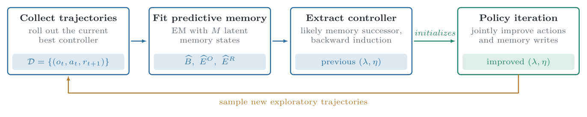
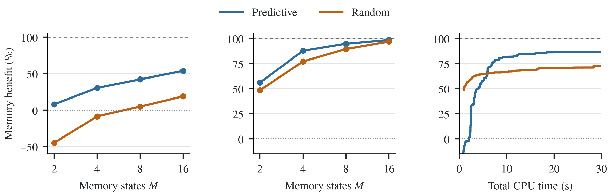
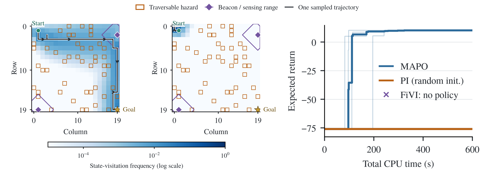

# Predictive Initialization of Finite-State Controllers for POMDPs

Code and experiments for the paper **Predictive Initialization of Finite-State Controllers for POMDPs**
by Oliver Baumgartner, Niklas Schmid, Liam Cregg, Kevin Wallington and John Lygeros
(Automatic Control Laboratory, ETH Zurich). <!-- TODO: paper link (L4DC 2027 / arXiv) -->

Finite-state controllers compress a POMDP's history into a few memory states, but optimizing
their memory and actions with policy iteration often gets stuck in poor local optima.
**MAPO** initializes the controller *predictively*. It trains a small memory that, together
with the current observation and action, predicts the next observation and reward. Policy
iteration on the known POMDP then refines the extracted controller, and the procedure repeats
with trajectories from the improved controller.



## Results

On long-horizon robot navigation, MAPO achieves higher returns than the belief-based solver
FiVI, with more than 10× lower planning cost and a stored policy about 5,000× smaller.
Across 22 standard POMDP benchmarks it matches or exceeds FiVI on 17, improving returns by up
to 21% and losing at most 6.3% on the remaining five.



*Predictive versus random initialization (IQM across benchmarks). Left: memory benefit from
one initialization followed by policy iteration. Middle: after 75 CPU seconds per memory size.
Right: anytime memory benefit at M = 4.*



*Navigation on a 20×20 grid with beacon sensing range k = 3. Left and middle: pre-goal
occupation and a sampled path for MAPO and for policy iteration from a random initialization.
Right: best return so far for four seeds (thick line: median). FiVI finds no policy within the
budget.*

## Quick start with Docker

The image contains the package, all models and the experiment plans. It needs no network
access at runtime.

```sh
docker pull ghcr.io/oiver12/predictive-fsc:latest
mkdir -p outputs
docker run --rm --network none --user "$(id -u):$(id -g)" \
  -v "$PWD/outputs:/outputs" ghcr.io/oiver12/predictive-fsc \
  solve models/tiger_episodic.toml --memory 4 --cpu-seconds 30 --output /outputs/tiger.npz
docker run --rm -v "$PWD/outputs:/outputs" ghcr.io/oiver12/predictive-fsc \
  evaluate models/tiger_episodic.toml /outputs/tiger.npz
```

To build the image yourself:

```sh
docker build --build-arg SOURCE_REVISION="$(git rev-parse HEAD)" -t predictive-fsc .
```

The image runs MAPO and the random-initialization baseline (`solve`, `halving`, `evaluate`,
`figures`, and plans without external solvers). FiVI and SAYNT run in their own containers,
which the host-installed CLI starts (see [Baselines](#baselines)).

## Local installation

Requires Python ≥ 3.11 and a C++17 compiler. The EM fit is a C++ extension built during installation.

```sh
uv sync                        # or: pip install -e .
source .venv/bin/activate
predictive-fsc validate models/*.toml
predictive-fsc solve models/tiger_episodic.toml --memory 4 --cpu-seconds 30
predictive-fsc halving models/hallway.toml --memory 2 4 8 16 --cpu-seconds 150
```

`solve` runs one search; `halving` runs successive halving over several memory sizes. Every
run is single-threaded and saves an `.npz` with the controller, the candidate trace, settings,
seeds and build provenance. `predictive-fsc <command> --help` lists all options. A search stops at
`--cpu-seconds` or `--rounds`, whichever comes first.

## Reproducing the paper

Each experiment is a TOML plan of explicit `[[runs]]` entries in `experiments/`:

| Plan | Jobs | Contents |
| --- | ---: | --- |
| `main.toml` | 308 | 22 benchmarks × 4 seeds: predictive and random halving over M = 2/4/8/16, random M = 1, FiVI and SAYNT at matched budgets |
| `main-extended.toml` | 22 | FiVI references, 7,200 CPU seconds |
| `navigation.toml` | 39 | 3 layouts × 4 seeds: predictive M = 4, random M = 4 and M = 1, FiVI |
| `navigation-extended.toml` | 3 | FiVI references: W20 7,200 wall seconds on 32 threads, W16 7,200 CPU seconds; 48 GiB heap |
| `tiger.toml` | 2 | Tiger H = 8, M = 4: 2,000 random starts and a FiVI reference |
| `appendix/distractor.py` | 240 | Distractor T-maze: 8 distractor lengths × 30 repetitions, M = 2 |

Budgets: B = 150 CPU seconds per memory size (600 for hallway, mit and both RockSample
problems). Halving uses 3B in total, and the external baselines get the same 3B. Seeds are
2026102901–2026102904. Navigation runs get 600 CPU seconds.

The main budgets alone add up to 48 CPU hours, the extended references to 44 CPU hours and
navigation to 6.5 CPU hours. <!-- TODO: replace with measured wall time from the final run -->

### Running plans

```sh
predictive-fsc reproduce experiments/main.toml --dry-run          # list all jobs
predictive-fsc reproduce experiments/main.toml --output outputs/main
predictive-fsc reproduce experiments/main.toml --run-index 7 --output outputs/main   # one job (1-based)
```

Completed jobs are skipped when a plan is rerun; `--force` reruns them.

### In parallel

Every job is independent and single-threaded. `tools/reproduce_parallel.py` checks the whole
plan, then uses [GNU Parallel](https://www.gnu.org/software/parallel/) to run one
`reproduce --run-index N` process per job, at most `--jobs` at a time:

```sh
python tools/reproduce_parallel.py experiments/main.toml --jobs 16 --output outputs/main-parallel
python tools/reproduce_parallel.py experiments/main-extended.toml --jobs 16 --output outputs/main-extended-parallel
python tools/reproduce_parallel.py experiments/navigation.toml --jobs 4 --output outputs/navigation-parallel
python tools/reproduce_parallel.py experiments/navigation-extended.toml --jobs 1 --output outputs/navigation-extended-parallel
```

Each job writes to `job-N/` (results, stdout, stderr), and `joblog.tsv` records timing and exit
status. Rerunning the same command resumes the batch and skips finished jobs. Ctrl-C stops the batch and removes
its solver containers. Choose `--jobs` from your core count and memory. Navigation FiVI jobs
need large heaps, so run them one at a time.

### Figures and tables

```sh
predictive-fsc figures outputs/main-parallel/job-*/ outputs/main-extended-parallel/job-*/ --paper main --output outputs/figures/main
predictive-fsc figures outputs/navigation-parallel/job-*/ outputs/navigation-extended-parallel/job-*/ --paper navigation --output outputs/figures/navigation
predictive-fsc figures outputs/tiger --paper tiger --output outputs/figures/tiger
python experiments/appendix/distractor.py --output outputs/distractor           # run
python experiments/appendix/distractor.py --output outputs/distractor --plot    # plot
```

| Paper item | Output |
| --- | --- |
| Figure 1a | `--paper tiger` |
| Figure 3, Table 1, Figure 4 | `--paper main` (initialization panels, `returns-and-storage.csv`, per-benchmark anytime) |
| Table 2, Figure 5 | `--paper navigation` |
| Figure 6 / Appendix C.1 | `appendix/distractor.py --plot` |

Plotting reads saved results only and never runs a solver. Panels show the paper's quantities
but are not pixel-identical copies of its layout. Missing results stay blank rather than zero.

### Archived results

The results from our final run are on Zenodo <!-- TODO: DOI + SHA256 -->. Download and
extract them, then run the `figures` commands above on the extracted directories. This
regenerates every figure and table without rerunning any solver.

CPU-budget results depend on hardware. Rerun numbers will differ slightly from the archive,
while runs with a fixed `--rounds` are deterministic for a given seed.

## Baselines

FiVI and SAYNT run in their own pinned Docker images. Build them once on the host that runs
the plans:

```sh
docker build -t predictive-fsc .                                      # FiVI builds on the core image
docker build --platform linux/amd64 -t predictive-fsc-fivi baselines/fivi
docker build -t predictive-fsc-saynt baselines/saynt                  # compiles Storm; slow
```

- **FiVI** builds [our corrected fork](https://github.com/oiver12/ConstrainedPlanningToolbox)
  of Walraven and Spaan's ConstrainedPlanningToolbox at a pinned revision, from a checksummed
  archive. Reported values are lower bounds, checked
  against the initial alpha vector. `FIVI_HEAP` and `FIVI_PROCESSORS` set the resources.
- **SAYNT** builds pinned [PAYNT](https://github.com/randriu/paynt),
  [Storm](https://github.com/randriu/storm), carl, pycarl and
  [Stormpy](https://github.com/oiver12/stormpy) (our fork with an ownership fix) and runs PAYNT
  directly, with 60 s and 10 s phases. Finite horizons are encoded by unrolling stages and
  shifting rewards.

The adapters (`src/predictive_fsc/baselines/`) convert each problem, run one container per job
without network access and record the image ID with the result. Upstream sources and licenses
are kept in the images under `/opt/fivi/source` and `/opt/saynt/source`.

## Problems

Each problem is a standard [Cassandra `.pomdp`](https://pomdp.org/code/pomdp-file-spec.html)
model plus a small TOML description:

```toml
model = "tiger_episodic.pomdp"
horizon = 8
discount = 1.0
terminal_actions = ["open_left", "open_right"]
terminal_states = []
```

All five fields are required. The objective is the undiscounted finite-horizon return.
Termination is never inferred, so terminal actions and states must be listed explicitly. A
terminal step still receives its reward and observation. Rewards are reduced to the expected
`r(s, a)`. To add a problem, write a `.pomdp` file and a TOML file next to it, then run
`predictive-fsc validate`.

`models/` contains the 22 benchmarks, three navigation layouts and eight distractor T-mazes.
Many benchmarks come from Tony Cassandra's [POMDP examples](https://pomdp.org/examples/).
<!-- TODO: per-model sources for 1d_noisy, line4_2goals, aloha10, bridge_repair, tmaze_* -->
New RockSample and navigation variants can be generated from explicit parameters:

```sh
python tools/generate_rocksample.py --help
python tools/generate_navigation.py --help
```

## Code layout

```text
src/predictive_fsc/
  types.py         data types: POMDP, Problem, Controller, SearchConfig, results
  dynamics.py      transition preparation, Bellman and occupancy operations
  policy.py        exact evaluation and policy iteration
  sampling.py      exploratory trajectory sampling (Numba)
  em.py            predictive EM fit, implemented in cpp/em.cpp
  extraction.py    controller extraction from the fitted predictive model
  search.py        MAPO search and successive halving
  io/              .pomdp/TOML problems, saved results and provenance
  baselines/       FiVI and SAYNT adapters
  reproduction.py  TOML plan execution
  analysis/        saved-result analysis, paper figures and tables
  cli.py           command-line interface
cpp/em.cpp         complete EM fit (pybind11)
experiments/       paper plans and the distractor appendix script
models/            .pomdp models and TOML problem descriptions
baselines/         FiVI and SAYNT image recipes
tools/             parallel launcher and model generators
```

## Citation

```bibtex
@inproceedings{baumgartner2027predictive,
  title     = {Predictive Initialization of Finite-State Controllers for {POMDPs}},
  author    = {Baumgartner, Oliver and Schmid, Niklas and Cregg, Liam and Wallington, Kevin and Lygeros, John},
  booktitle = {Proceedings of the Learning for Dynamics and Control Conference (L4DC)},
  year      = {2027}
}
```

## License and acknowledgements

MIT, see [LICENSE](LICENSE). The scaled forward–backward routines in `cpp/em.cpp` are inspired by
[hmmlearn](https://github.com/hmmlearn/hmmlearn) (BSD). Benchmark models are from Cassandra's POMDP
examples and the cited benchmark papers. Baseline images build FiVI, PAYNT and Storm under their
own licenses. If you use the parallel launcher, please also cite GNU Parallel (`parallel --citation`).
