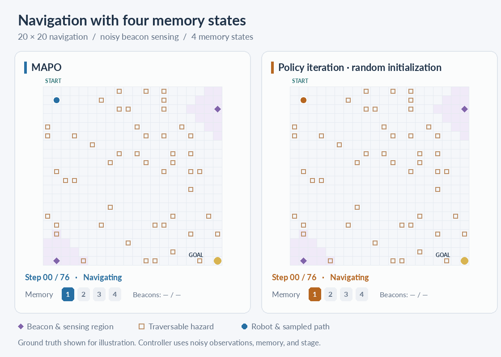

<div align="center">

# MAPO
### Predictive Initialization of Finite-State Controllers for POMDPs

Code and experiments for the paper above.

Oliver Baumgartner · Niklas Schmid · Liam Cregg · Kevin Wallington · John Lygeros<br>
Automatic Control Laboratory, ETH Zurich

[How it works](#how-it-works) · [Results](#results) · [Quick start](#quick-start) · [Reproduce the paper](#reproduce-the-paper) · [Citation](#citation)

</div>



*Navigation with four memory states. The robot knows the map but observes only noisy beacon readings. MAPO heads toward a beacon, then follows the boundary to the goal. Policy iteration from random initialization stays near the start.*

The robot’s position is shown for illustration; the controller uses its observations, memory, and current time step. [Static image](assets/navigation-demo.png)

| **4 memory states** | **17 / 22 benchmarks** | **≈5,000× smaller** |
| :---: | :---: | :---: |
| [Long-horizon navigation](#robot-navigation) | [Matches or exceeds FiVI](#standard-benchmarks) | [Stored navigation policy vs. FiVI](#robot-navigation) |

## How it works

A finite-state controller solves a partially observable Markov decision process (POMDP) by keeping a small memory of past observations and actions. Policy iteration improves the controller, but often gets stuck: a memory update is useful only if a later action uses the information it stores. In our Tiger experiment, only **3% of randomly initialized controllers** achieve positive return after policy iteration converges.

We use predictive initialization to give policy iteration a better starting point. **MAPO** (memory-augmented policy optimization) fits a small memory to simulated trajectories, training it to predict the next observation and reward given the current observation and action. We extract a controller from this model, refine it with policy iteration on the known POMDP, and repeat using trajectories from the improved controller.


The controller is deterministic and stage-dependent: its action and memory-update rules can change with the time remaining in the episode.

## Results

### Standard benchmarks

With the same total CPU budget, MAPO **matches or exceeds FiVI on 17 of 22 POMDP benchmarks**. Returns improve by up to 21%; on the five benchmarks where FiVI performs better, MAPO falls behind by at most 6.3%. FiVI’s policies use a median of 82× as much storage as MAPO’s.


*Improvement over memoryless policies, aggregated using the interquartile mean. Left: one initialization followed by policy iteration. Middle: 75 CPU seconds per memory size. Right: search over time at M = 4. The aggregate excludes three benchmarks with negligible memory benefit; the solver comparison includes all 22.*

### Robot navigation

On the 20×20 grid (beacon range 3, horizon 76), all four MAPO runs find controllers with a goal-reaching probability above 0.999. The random-initialization baseline returns −76 in every run. FiVI finds no policy within 600 CPU seconds; after two wall-clock hours, its return is 6.61, compared with 10.10 for MAPO.

| Method | Planning allowance | Expected return | Policy storage |
| --- | --- | ---: | ---: |
| **MAPO, M = 4** | **600 CPU seconds** | **10.10 ± 0.18** | **15.0 kB** |
| PI, random initialization, M = 4 | 600 CPU seconds | −76.00 ± 0.00 | 15.0 kB |
| FiVI | 600 CPU seconds | No policy | — |
| FiVI, extended | 2 wall-clock hours, 32 threads | 6.61 | 71,570 kB |

*MAPO and random PI: mean ± standard deviation over four seeds. Policy storage counts numerical entries, excluding the model and file overhead. The extended FiVI run uses 32 threads for two wall-clock hours; the other budgets are CPU time.*


*MAPO visits a beacon before following the right boundary. The curves show four seeds and their median; the paths illustrate individual rollouts.*

## Quick start

With Docker installed, the following commands solve and evaluate Tiger. The image includes the package, models, and experiment plans.

```sh
docker pull ghcr.io/oiver12/predictive-fsc:latest
mkdir -p outputs
docker run --rm --network none --user "$(id -u):$(id -g)" \
  -v "$PWD/outputs:/outputs" ghcr.io/oiver12/predictive-fsc \
  solve models/tiger_episodic.toml --memory 4 --cpu-seconds 30 --output /outputs/tiger.npz
docker run --rm --network none -v "$PWD/outputs:/outputs" \
  ghcr.io/oiver12/predictive-fsc \
  evaluate models/tiger_episodic.toml /outputs/tiger.npz
```

For local installation, use Python ≥ 3.11 and a C++17 compiler:

```sh
uv sync
source .venv/bin/activate
predictive-fsc solve models/tiger_episodic.toml --memory 4 --cpu-seconds 30
```

To reproduce a specific revision, [build the image from source](docs/reproduction.md#quick-start-with-docker) rather than using the moving `latest` tag.

## Reproduce the paper

Install the package locally, then build the baseline images and run the experiments:

```sh
uv sync
source .venv/bin/activate
make baselines
make reproduce JOBS=8
make figures
```

This runs all five paper plans and the distractor T-maze study. Repeating `make reproduce`
skips completed jobs. It defaults to one job; choose `JOBS` for your CPU and RAM.
Both navigation plans run one job at a time because FiVI requests 48 GiB heaps.
The extended 20×20 navigation runs also use 32 threads.

`make figures` reads saved results only. Results go under `outputs/`, with figures and
CSV tables under `outputs/figures/` and appendix plots under `outputs/distractor/`.
Use `OUTPUTS=/path/to/results` to change the root. Run `make` for help.

The full run requires Docker, GNU Make, and GNU Parallel. See the
[reproduction guide](docs/reproduction.md#run-the-paper) for setup, budgets, and individual commands.

Each run saves its controller, candidate trace, settings, seeds, and build provenance. Completed jobs are skipped on rerun. CPU-budget results vary with hardware; fixed-round runs are deterministic for a given seed.

## Repository structure

| Directory | Contents |
| --- | --- |
| [`src/predictive_fsc/`](src/predictive_fsc/) | Policy iteration, predictive fitting, controller search, CLI, and analysis |
| [`cpp/`](cpp/) | C++ EM implementation |
| [`experiments/`](experiments/) | Explicit paper plans and distractor T-maze experiment |
| [`models/`](models/) | Benchmark POMDPs and finite-horizon problem descriptions |
| [`baselines/`](baselines/) | FiVI and SAYNT container recipes |
| [`tools/`](tools/) | Parallel launcher and model generators |

To add a problem, see the [model format and validation instructions](docs/reproduction.md#problems).

## Citation

```bibtex
@unpublished{baumgartner2026predictive,
  title  = {Predictive Initialization of Finite-State Controllers for {POMDPs}},
  author = {Baumgartner, Oliver and Schmid, Niklas and Cregg, Liam and Wallington, Kevin and Lygeros, John},
  note   = {Unpublished manuscript},
  year   = {2026}
}
```

See also [CITATION.cff](CITATION.cff). The paper is currently an unpublished manuscript.

## License and acknowledgements

MIT, see [LICENSE](LICENSE). The scaled forward–backward routines in `cpp/em.cpp` are inspired by
[hmmlearn](https://github.com/hmmlearn/hmmlearn) (BSD). Benchmark models are from Cassandra's POMDP
examples and the cited benchmark papers. Baseline images build FiVI, PAYNT and Storm under their
own licenses. If you use the parallel launcher, please also cite GNU Parallel (`parallel --citation`).
